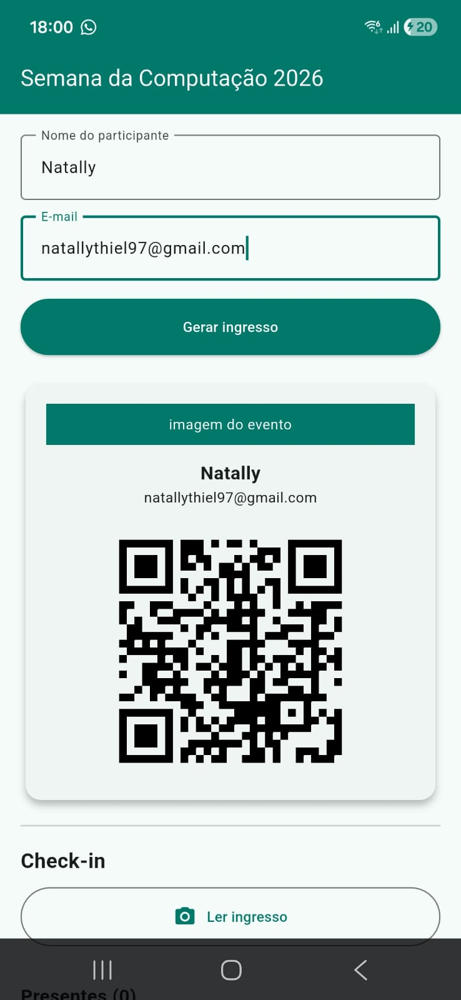

# 🎟️ AP2 - App de Check-in de Eventos

Aplicativo mobile desenvolvido em **Flutter** para gestão de ingressos e check-in de participantes em eventos através de **QR Code**. O sistema permite gerar bilhetes individuais e realizar a validação presencial em tempo real utilizando a câmera do dispositivo, mantendo a lista de presença atualizada em memória.

---

## 📌 Sobre o Projeto

Este projeto foi desenvolvido como avaliação prática (AP2) com o objetivo de construir uma solução de **página única** (single-page) sem navegação por rotas, integrando geração de QR Codes, leitura via câmera e controle de estado local.

### 🎯 Funcionalidades
- **Geração de Ingresso:** Formulário para inserção do nome e e-mail do participante.
- **QR Code Padronizado:** Criação de QR Code no formato seguro `CHECKIN|nome|e-mail`.
- **Validação com Câmera:** Leitura do QR Code com tratamento para 3 cenários distintos:
    -  **Check-in confirmado:** Ingresso válido e participante novo.
    - ⚠️ **Já fez check-in:** Ingresso válido, mas o nome já consta na lista de presença.
    - ✖️ **QR inválido:** Leitura de códigos externos ou fora do padrão do evento.
- **Lista de Presença:** Contador dinâmico e exibição dos nomes confirmados em memória.

---

## 📸 Prints funcionais:

### 1. Ingresso Gerado


---

## 📁 Estrutura de Pastas

```text
lib/
├── main.dart
└── telas/
    └── TelaPrincipal.dart

